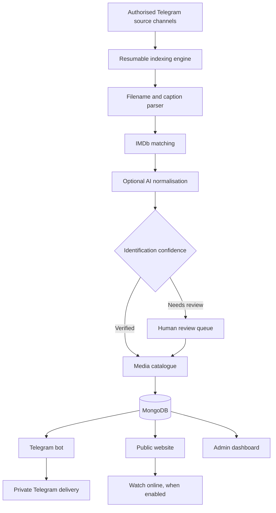

<div align="center">


# AJ CINE AI

### AI-assisted Telegram movie and TV-series indexing, identification, catalogue and delivery platform

**Developed by AJ APPLICATIONS**  
**Developer: AJWEYA**

[](https://www.python.org/)
[](https://fastapi.tiangolo.com/)
[](https://www.mongodb.com/)
[](https://www.docker.com/)
[](https://www.microsoft.com/windows)
[](https://www.linux.org/)
[](https://www.apple.com/macos/)

</div>

---

##  About AJ CINE AI

AJ CINE AI is a self-hosted, AI-assisted media indexing and discovery platform built around Telegram. It helps administrators organise movie and TV-series files from Telegram channels they are authorised to access, identify titles, build a searchable catalogue, and deliver the original indexed Telegram files to users.

The project brings several parts of a media catalogue workflow into one application:

- A Telegram bot for searching titles, navigating available versions and receiving files.
- An indexing engine that reads Telegram channel messages and records file metadata.
- A multi-stage identification pipeline using filename parsing, IMDb matching, optional AI normalisation and human review.
- A catalogue that organises movies and series, including seasons and episodes.
- A public website for browsing, searching and, when explicitly enabled, streaming supported files.
- An administrator dashboard and Telegram admin panel for managing the system.

AJ CINE AI is designed to be self-hosted. You can run it directly on Windows, Linux or macOS, use Docker, or deploy it to a suitable Linux server.

> **Content and permissions:** Only index, access and distribute media that you own or are otherwise authorised to use. AJ CINE AI does not grant rights to content stored in Telegram channels.

##  Table of contents

- [About AJ CINE AI](#-about-aj-cine-ai)
- [Project overview](#-project-overview)
- [How it works](#-how-it-works)
- [Features](#-features)
- [Architecture](#-architecture)
- [Requirements](#-requirements)
- [Installation](#-installation)
  - [Windows](#windows-installation)
  - [Linux](#linux-installation)
  - [macOS](#macos-installation)
  - [Docker](#docker-installation)
- [Configuration](#-configuration)
- [Telegram setup](#-telegram-setup)
- [Media identification](#-media-identification)
- [IMDb datasets](#-imdb-datasets)
- [OpenRouter AI](#-openrouter-ai)
- [TMDB artwork](#-tmdb-artwork)
- [Collections and files](#-collections-and-files)
- [Public website and streaming](#-public-website-and-streaming)
- [Telegram bot](#-telegram-bot)
- [Administrator dashboard](#-administrator-dashboard)
- [Advertisements and broadcasts](#-advertisements-and-broadcasts)
- [Database configuration](#-database-configuration)
- [Deployment](#-deployment)
- [Backups and recovery](#-backups-and-recovery)
- [Security](#-security)
- [Development and tests](#-development-and-tests)
- [Troubleshooting](#-troubleshooting)
- [Known limitations](#-known-limitations)
- [Contributing](#-contributing)
- [Credits and licences](#-credits-and-licences)

##  Project overview

| Item | Details |
|---|---|
| Project | AJ CINE AI |
| Organisation | AJ APPLICATIONS |
| Developer | AJWEYA |
| Runtime | Python 3.12 |
| Web framework | FastAPI |
| Telegram integration | Pyrogram |
| Main application database | MongoDB |
| IMDb/Cinemagoer database | SQLite by default |
| Optional cache | Redis |
| AI provider | OpenRouter |
| Artwork provider | TMDB |
| Container support | Docker and Docker Compose |
| Local operating systems | Windows, Linux and macOS |

### What happens when a file is indexed?

Suppose an authorised Telegram source channel contains files such as:

```text
Inception.2010.1080p.BluRay.x265.Hindi.mkv
Inception.2010.720p.WEBRip.English.mkv
Breaking.Bad.S01E01.1080p.mkv
Breaking.Bad.S01E02.720p.Hindi.mkv
```

AJ CINE AI reads the message metadata, parses the filename and caption, attempts to identify the title, and associates the upload with a movie or series collection. Each upload remains an individual file record with its own quality, language, source and Telegram file reference.

Users can then search for a title and choose from the versions that actually exist in the index.

**Indexing does not download the media file to the application server.** The application stores Telegram file identifiers and source message references. Streaming, if enabled, relays the file through the application and therefore uses server bandwidth.

##  How it works



### Identification order

The identification pipeline is deliberately designed so that AI output is not accepted as truth on its own.

1. **Manual corrections:** previously accepted administrator corrections take priority.
2. **Filename parser:** extracts title, year, season, episode, quality, codecs and language hints.
3. **IMDb matching:** compares the parsed title with IMDb data using weighted matching.
4. **AI normalisation:** an optional OpenRouter model can help normalise difficult filenames and search text.
5. **Human review:** uncertain matches are held for an administrator to inspect.

The configured confidence thresholds determine whether a result can be accepted automatically or should be reviewed. Manual corrections remain in effect during later re-indexing.

### Core data flow

```text
Telegram message
    |
    v
File metadata and source reference
    |
    v
Parser and identification pipeline
    |
    +----> Verified movie/series collection
    |
    +----> Review queue
    |
    v
MongoDB catalogue and file records
    |
    +----> Telegram search and delivery
    |
    +----> Public website
    |
    +----> Administrator dashboard
```

##  Features

### Indexing and catalogue

- Index message history from configured Telegram source channels.
- Process new uploads as they arrive.
- Resume interrupted indexing jobs from stored checkpoints.
- Track indexing jobs and their status.
- Detect duplicate source messages.
- Associate alternative source uploads with an existing file record.
- Organise movies and series into collections.
- Organise series into seasons and episodes.
- Preserve manual corrections across future indexing runs.

### Search and discovery

- Search movies and series from Telegram.
- Handle common spelling mistakes and title variations.
- Support transliterated search terms, including Manglish-style input where supported by the search implementation.
- Apply search filters and cache results.
- Browse the same indexed catalogue through the public website.
- Request titles that are not currently indexed.

### Language and quality navigation

Language and quality options are derived from real, non-deleted file records. The application does not create a language or resolution option simply because it appears in a collection title.

Example of the user flow:

```text
Search: Inception

Select a matching title
    |
    v
Choose an available language
    |
    v
Choose an available quality
    |
    v
Get the file in a private Telegram chat
```

### Administration

- Review uncertain title matches.
- Correct media metadata.
- Change IMDb identifiers.
- Set or update poster URLs.
- Merge duplicate collections.
- Edit file-level language, quality, season and episode details.
- Inspect correction history and undo supported corrections.
- Manage source channels and indexing jobs.
- Manage users and administrator roles.
- Configure AI and IMDb integrations.
- Create and restore application backups.
- Review system health and logs.

##  Architecture

AJ CINE AI is a Python application with separate responsibilities for Telegram interaction, indexing, identification, catalogue storage and web delivery.

| Component | Responsibility |
|---|---|
| Telegram bot | Search, navigation, user interaction and file delivery |
| Indexing engine | Reads authorised Telegram messages and records uploads |
| Filename parser | Extracts media metadata from filenames and captions |
| IMDb integration | Matches titles against imported IMDb datasets |
| AI integration | Optional filename and title normalisation |
| MongoDB | Stores application catalogue, files, users, settings and activity |
| SQLite/Cinemagoer | Provides the local IMDb title lookup database by default |
| FastAPI | Serves the website, dashboard and application endpoints |
| Public website | Provides catalogue browsing, searching and optional streaming |
| Admin dashboard | Provides web-based management |
| TMDB integration | Supplies poster and backdrop URLs |
| Redis | Optional shared cache for supported deployments |

### Technology stack

<div align="center">

[](https://www.python.org/)
[](https://fastapi.tiangolo.com/)
[](https://www.mongodb.com/)
[](https://www.sqlite.org/)
[](https://www.docker.com/)
[](https://redis.io/)

</div>

##  Requirements

### Required software

| Requirement | Purpose |
|---|---|
| Python 3.12 | Runs the application |
| MongoDB | Main application database |
| Telegram API ID and API Hash | Telegram client access |
| Telegram bot token | Bot authentication |
| Git | Clone and update the repository |
| pip | Install Python dependencies |

### Optional services

| Service | Used for |
|---|---|
| Docker | Container-based installation |
| Docker Compose | Running the application and supporting services together |
| Redis | Shared caching in supported multi-process deployments |
| OpenRouter API key | AI-assisted normalisation |
| TMDB API key or read token | Posters and backdrops |
| Telegram user session | Historical indexing where bot access is insufficient |

A stable internet connection is needed for Telegram and external integrations. Storage and memory needs depend on catalogue size, IMDb dataset files, indexing volume, database size and streaming activity.

---

#  Installation

Choose the installation method that matches your computer. For local development, installing Python and running the application in a virtual environment is usually the most straightforward approach.

## Windows installation

These instructions are for Windows 10 and Windows 11 using PowerShell.

### 1. Install Python 3.12

Download Python:

https://www.python.org/downloads/release/python-3120/

During installation, enable **Add Python to PATH**.

Verify the installation:

```powershell
py -3.12 --version
python --version
```

If `python` points to a different version, use `py -3.12` for the commands below.

### 2. Install Git

Download Git for Windows:

https://git-scm.com/downloads/win

Verify:

```powershell
git --version
```

### 3. Install MongoDB Community Server

Download MongoDB Community Server:

https://www.mongodb.com/try/download/community

Install it as a Windows service. MongoDB Compass is optional but useful for inspecting your database:

https://www.mongodb.com/products/tools/compass

Check the service:

```powershell
Get-Service MongoDB
```

If it is stopped:

```powershell
Start-Service MongoDB
```

The default local MongoDB URI is:

```text
mongodb://localhost:27017
```

### 4. Clone the repository

Replace the placeholder with the actual repository URL:

```powershell
git clone https://github.com/ajweya/ajcineai.git ajcineai
cd ajcineai
```

### 5. Create and activate a virtual environment

```powershell
py -3.12 -m venv .venv
.\.venv\Scripts\Activate.ps1
```

If PowerShell blocks activation scripts, allow them for the current terminal process only:

```powershell
Set-ExecutionPolicy -Scope Process -ExecutionPolicy Bypass
.\.venv\Scripts\Activate.ps1
```

### 6. Install dependencies

For development and testing:

```powershell
python -m pip install --upgrade pip
pip install -r requirements-dev.txt
```

For a runtime-only installation:

```powershell
python -m pip install --upgrade pip
pip install -r requirements.txt
```

### 7. Create the environment file

```powershell
Copy-Item .env.example .env
notepad .env
```

Fill in the required Telegram, MongoDB and web security settings. See [Configuration](#-configuration).

### 8. Start AJ CINE AI

```powershell
python -m ajcine
```

Open these addresses in your browser:

| Page | Local address |
|---|---|
| Public website | http://127.0.0.1:8000/ |
| Admin dashboard | http://127.0.0.1:8000/admin |
| Health check | http://127.0.0.1:8000/healthz |

Keep the terminal open while the application is running. Press `Ctrl+C` to stop it gracefully.

## Linux installation

These instructions are for Ubuntu and Debian-based systems. Other distributions may use different package names and service commands.

### 1. Update the system

```bash
sudo apt update
sudo apt upgrade -y
```

### 2. Install required packages

```bash
sudo apt install -y \
    git \
    python3.12 \
    python3.12-venv \
    python3-pip \
    build-essential \
    curl
```

If Python 3.12 is not available in your distribution's configured repositories, use a supported installation method for your distribution.

### 3. Install MongoDB

Follow the official instructions for your distribution:

https://www.mongodb.com/docs/manual/administration/install-on-linux/

On installations that use the `mongod` systemd service:

```bash
sudo systemctl enable --now mongod
sudo systemctl status mongod
```

### 4. Clone the repository

```bash
git clone https://github.com/ajweya/ajcineai.git ajcineai
cd ajcineai
```

### 5. Create and activate a virtual environment

```bash
python3.12 -m venv .venv
source .venv/bin/activate
```

### 6. Install dependencies

```bash
python -m pip install --upgrade pip
pip install -r requirements-dev.txt
```

For a runtime-only installation, use `requirements.txt` instead.

### 7. Configure the application

```bash
cp .env.example .env
nano .env
```

Enter your credentials and settings.

### 8. Run the application

```bash
python -m ajcine
```

Open `http://127.0.0.1:8000/` and sign in to the dashboard at `/admin`.

## macOS installation

These instructions cover Apple Silicon and Intel Macs, subject to the availability of compatible Python packages and dependencies.

### 1. Install Homebrew

If Homebrew is not installed, follow:

https://brew.sh/

### 2. Install Python and Git

```bash
brew install python@3.12 git
```

Verify:

```bash
python3.12 --version
git --version
```

### 3. Install MongoDB

Follow the official macOS instructions:

https://www.mongodb.com/docs/manual/tutorial/install-mongodb-on-os-x/

If you installed MongoDB through a Homebrew formula that provides the `mongodb-community` service, you can start it with:

```bash
brew services start mongodb-community
```

Check services:

```bash
brew services list
```

The exact formula and service name depend on the MongoDB version and installation method you selected.

### 4. Clone the repository

```bash
git clone https://github.com/ajweya/ajcineai.git ajcineai
cd ajcineai
```

### 5. Create and activate a virtual environment

```bash
python3.12 -m venv .venv
source .venv/bin/activate
```

### 6. Install dependencies

```bash
python -m pip install --upgrade pip
pip install -r requirements-dev.txt
```

### 7. Configure the application

```bash
cp .env.example .env
nano .env
```

Add the required credentials and settings.

### 8. Start AJ CINE AI

```bash
python -m ajcine
```

Open:

- Website: http://127.0.0.1:8000/
- Dashboard: http://127.0.0.1:8000/admin
- Health check: http://127.0.0.1:8000/healthz

## Docker installation

Docker is an alternative to installing the Python environment directly on your host. The supplied Dockerfile builds a Linux container image, which can be run through Docker Engine on Linux or Docker Desktop on Windows and macOS.

### 1. Install Docker

- [Docker Desktop for Windows](https://docs.docker.com/desktop/setup/install/windows-install/)
- [Docker Engine for Linux](https://docs.docker.com/engine/install/)
- [Docker Desktop for macOS](https://docs.docker.com/desktop/setup/install/mac-install/)

Verify:

```bash
docker --version
docker compose version
```

### 2. Clone the repository

```bash
git clone https://github.com/ajweya/ajcineai.git ajcineai
cd ajcineai
```

### 3. Configure environment variables

Linux/macOS:

```bash
cp .env.example .env
```

Windows PowerShell:

```powershell
Copy-Item .env.example .env
```

Edit `.env` and configure the required values.

> **Docker networking:** Inside a container, `localhost` refers to that container, not your host machine or another container. If MongoDB is a Compose service, use its Compose service name in `MONGO_URI`. If MongoDB runs on the host, use the appropriate host address for your Docker platform.

### 4. Build and start

```bash
docker compose up -d --build
```

### 5. Follow application logs

```bash
docker compose logs -f app
```

### 6. Stop the services

```bash
docker compose down
```

To restart the application:

```bash
docker compose restart
```

### About the Dockerfile

The supplied Dockerfile:

1. Uses `python:3.12-slim` as its base image.
2. Sets `/app` as the working directory.
3. Installs Python dependencies from `requirements.txt`.
4. Installs temporary build tools for packages that need compilation, then removes them.
5. Copies the `ajcine` application package.
6. Creates an unprivileged `ajcine` user.
7. Creates `/app/data` and assigns it to the application user.
8. Declares `/app/data` as a volume.
9. Exposes port `8000`.
10. Checks `/healthz` using Docker's health-check mechanism.
11. Starts the application with `python -m ajcine`.

The Dockerfile builds the application image; it does not itself install or start MongoDB or Redis. Those services must be configured separately or defined in the repository's Compose file.

---

##  Configuration

AJ CINE AI reads configuration from environment variables. The full annotated reference is `.env.example`.

### Required settings

| Variable | Description |
|---|---|
| `API_ID` | Telegram API ID |
| `API_HASH` | Telegram API hash |
| `BOT_TOKEN` | Telegram bot token |
| `OWNER_IDS` | Comma-separated Telegram owner user IDs |
| `MONGO_URI` | Main MongoDB connection URI |
| `WEB_SECRET_KEY` | Secret used by web security and sessions |

The application validates required settings and reports configuration problems before starting.

### Generate a secure web secret

Run:

```bash
python -c "import secrets; print(secrets.token_urlsafe(48))"
```

Put the generated value in `.env`:

```dotenv
WEB_SECRET_KEY=your_generated_secret
```

The key must be at least 32 characters long.

### Example environment configuration

This is a small starting example. Keep the other settings from the repository's `.env.example` when configuring a full installation.

```dotenv
# Telegram
API_ID=123456
API_HASH=your_telegram_api_hash
BOT_TOKEN=your_bot_token
OWNER_IDS=123456789

# MongoDB
MONGO_URI=mongodb://localhost:27017
MONGO_DB=ajcineai

# Web application
WEB_HOST=127.0.0.1
WEB_PORT=8000
WEB_SECRET_KEY=replace_with_a_secure_secret_of_at_least_32_characters

# Initial administrator account
ADMIN_BOOTSTRAP_USER=admin
ADMIN_BOOTSTRAP_PASSWORD=change_this_password

# IMDb
IMDB_DB_URI=sqlite:///data/cinemagoer.db
IMDB_DATASET_DIR=data/imdb-datasets
IMDB_UPDATE_DAYS=14

# Optional AI integration
OPENROUTER_API_KEY=
OPENROUTER_MODEL=
OPENROUTER_FALLBACK_MODELS=
AI_ENABLED=true

# Optional artwork integration
TMDB_API_KEY=
TMDB_READ_TOKEN=

# Optional cache
REDIS_URL=

# Public website and streaming
PUBLIC_SITE_ENABLED=true
STREAMING_ENABLED=false
PUBLIC_BASE_URL=

# Advertisements
ADS_ENABLED=true
```

### Initial administrator account

On the first successful startup, the application creates the bootstrap owner account using `ADMIN_BOOTSTRAP_USER` and `ADMIN_BOOTSTRAP_PASSWORD`.

The bootstrap account is created only once. After confirming that the owner account works, remove the bootstrap password from the environment configuration. Changing the bootstrap environment variable later does not automatically reset an existing administrator password.

### Web host and port

For local-only access, use:

```dotenv
WEB_HOST=127.0.0.1
WEB_PORT=8000
```

For a container or server deployment where the application must accept connections through its container network, use the host configuration expected by the deployment, commonly:

```dotenv
WEB_HOST=0.0.0.0
PORT=8000
```

The application reads `PORT` before `WEB_PORT` when selecting the web port.

### Production cookies

After HTTPS is configured correctly, set:

```dotenv
WEB_SECURE_COOKIES=true
```

Do not enable secure cookies for a plain HTTP local development session unless you understand the browser behaviour this causes.

---

##  Telegram setup

AJ CINE AI uses Telegram for source indexing, search and file delivery.

### 1. Create a Telegram application

Open:

https://my.telegram.org

Sign in and create an application to obtain:

- API ID
- API Hash

Add these values to `.env`.

### 2. Create a bot

Open [@BotFather](https://t.me/BotFather) in Telegram and create a bot. Copy the token into:

```dotenv
BOT_TOKEN=your_bot_token
```

Keep the token private.

### 3. Configure owner IDs

Set at least one Telegram user ID:

```dotenv
OWNER_IDS=123456789
```

Multiple owner IDs can be separated with commas.

### 4. Add source channels

Add the bot to the source channels it is authorised to index and grant the permissions required to read their messages.

Then add each source through either:

- Web dashboard: **Indexing → Add source**
- Telegram panel: **Admin panel → Source channels**

Start history indexing after the source has been added.

### 5. Optional user session

Some historical indexing scenarios require a Telegram user account session when the bot cannot access the required channel history. Configure `SESSION_STRING` only when necessary.

A user session is sensitive account access. Never commit it to Git, paste it into public issues or share it with untrusted people.

---

##  Media identification

AJ CINE AI uses a staged identification process.

### Filename parser

The parser attempts to extract:

- Title
- Release year
- Season and episode
- Resolution
- Audio language hints
- Subtitle hints
- Video and audio codec information

### IMDb matching

Parsed titles are matched against the local IMDb/Cinemagoer database using weighted scoring.

The matching thresholds are configurable:

```dotenv
MATCH_AUTO_THRESHOLD=0.86
MATCH_REVIEW_THRESHOLD=0.55
```

The review threshold must remain lower than the automatic acceptance threshold.

### AI-assisted normalisation

If enabled, AI can help normalise filename text. AI output is not accepted as a verified IMDb match on its own.

### Human review

Uncertain matches are added to the review queue. Administrators can inspect candidates, search IMDb manually and correct the identification.

### Manual corrections

Manual corrections are stored and take priority over automatic identification during future indexing or re-indexing. This prevents an accepted human decision from being casually replaced by a later automated guess.

---

##  IMDb datasets

AJ CINE AI uses IMDb's downloadable datasets and Cinemagoer rather than scraping IMDb web pages.

Official dataset source:

https://datasets.imdbws.com/

The application downloads the required `.tsv.gz` files, verifies and resumes downloads where supported, imports them into a staging database and swaps the imported database into service atomically.

The initial import can take a substantial amount of time. The dashboard displays IMDb dataset status, and scheduled updates are controlled by `IMDB_UPDATE_DAYS`.

Default:

```dotenv
IMDB_UPDATE_DAYS=14
```

The default IMDb/Cinemagoer database is SQLite:

```dotenv
IMDB_DB_URI=sqlite:///data/cinemagoer.db
```

PostgreSQL is also supported through `requirements-postgres.txt`.

> **IMDb licensing:** IMDb's downloadable datasets are provided under non-commercial-use conditions. Review the current IMDb terms and confirm that your use complies before operating or distributing a commercial service.

IMDb datasets do not provide movie posters or backdrops. AJ CINE AI uses TMDB for artwork when configured.

---

##  OpenRouter AI

OpenRouter provides optional AI assistance for filename and title normalisation.

Website:

https://openrouter.ai/

### Configuration

```dotenv
OPENROUTER_API_KEY=your_api_key
OPENROUTER_MODEL=your_verified_free_model
OPENROUTER_FALLBACK_MODELS=
OPENROUTER_BASE_URL=https://openrouter.ai/api/v1
AI_ENABLED=true
```

Models can also be changed at runtime through the administrator dashboard or Telegram admin panel.

### Free-model checks

The application is designed to use verified free models only. Before a model is accepted, its pricing is checked against OpenRouter's live model catalogue.

A model must have zero prompt and completion pricing and no additional per-request, image or search fees.

If the catalogue is unavailable, only recognised free model identifiers, such as IDs ending in `:free` or `openrouter/free`, are accepted.

The application deliberately does not use OpenRouter's native model fallback array because that could route requests to a paid model. Configured fallback models are tried individually after verification.

### Request controls

AI requests are subject to:

- Local request throttling.
- Retry and `Retry-After` handling.
- Exponential backoff with jitter.
- Per-model circuit breakers.
- Immediate stop for relevant authentication, payment and daily-limit errors.
- Response caching.
- Background processing.

The default `AI_RPM` is 15 requests per minute, with an application-side maximum of 20.

AI can be disabled without disabling normal search and indexing.

---

##  TMDB artwork

TMDB supplies posters and backdrops for catalogue titles.

Website:

https://www.themoviedb.org/

Configure either a v3 API key:

```dotenv
TMDB_API_KEY=your_v3_api_key
```

or a v4 API read access token:

```dotenv
TMDB_READ_TOKEN=your_v4_read_access_token
```

The application stores artwork URLs rather than downloading and storing new poster images.

Artwork behaviour:

- IMDb titles can be looked up using their IMDb IDs.
- Local collections are matched conservatively by title and year.
- A poster set manually by an administrator is not automatically overwritten.
- Fetching a TMDB poster for a title can be requested explicitly by an administrator.
- Titles without artwork use a typographic placeholder.

> This product uses the TMDB API but is not endorsed or certified by TMDB. Artwork is served directly from TMDB's image CDN.

---

##  Collections and files

A collection represents one movie or one series. A file record represents one individual Telegram upload.

### Example movie collection

```text
Inception (2010)
|
+-- 1080p Hindi
+-- 1080p English
+-- 720p Hindi
+-- 480p English
```

The collection summarises its files, including file count and the languages and qualities that actually exist. It does not assign one quality or language to every file.

### File-level information

Each file record can contain:

- Filename
- Resolution
- Audio language hints
- Subtitle information
- Video and audio codecs
- File size
- Source message reference
- Telegram file identifier
- Collection association
- Season and episode details where applicable

### Local collection identifiers

Local collection IDs use a deterministic `loc_` identifier derived from the media type, normalised title and year. The same movie can therefore be grouped consistently even when uploads have different languages or resolutions.

A file without a year can join an existing collection for that title. Remakes with different years remain separate.

Set:

```dotenv
AUTO_LOCAL_COLLECTIONS=true
```

to group titles that IMDb cannot identify into local collections automatically. The default is `false`, so unidentified files wait for human review.

### Language and subtitles

Audio language hints can come from filenames, manual corrections or AI-assisted processing. Telegram does not expose the actual audio tracks through ordinary file metadata, so the application cannot independently verify the spoken language inside the video.

Subtitle information is stored separately from audio language information.

### Series structure

Series are organised as:

```text
Series
  |
  +-- Season
        |
        +-- Episode
              |
              +-- Available file versions
```

Each episode can have multiple language and quality versions.

### Duplicate uploads

A unique source-message index prevents the same source message from being recorded more than once. If the same upload is found in another chat, it can be stored as an alternative source for the existing file.

### Existing collection migration

Run a dry run first:

```bash
python -m ajcine.tools.collections migrate
```

Apply the migration only after reviewing the output:

```bash
python -m ajcine.tools.collections migrate --apply
```

Inspect collection and file information:

```bash
python -m ajcine.tools.collections report
```

Optional report filters:

```bash
python -m ajcine.tools.collections report --id COLLECTION_ID
python -m ajcine.tools.collections report --kind movie
python -m ajcine.tools.collections report --kind series --json
```

The migration is designed not to delete existing data. Existing identifiers are preserved according to the migration's merge rules.

---

##  Public website and streaming

The public website is served from `/`.

Default local address:

http://127.0.0.1:8000/

Visitors can browse and search the catalogue, open movie or series pages, select a language and quality, and navigate seasons and episodes.

### Watch online

Streaming is disabled by default:

```dotenv
STREAMING_ENABLED=false
```

When enabled, the website can stream indexed Telegram files through the application. HTTP Range requests are supported.

Streaming sends media through your server and consumes its network bandwidth. Enable it only when you have the necessary distribution rights and have planned for the bandwidth and concurrency requirements.

### Stream protection

Stream links are opaque, expire after the configured lifetime and are bound to a file. Telegram chat, message and file identifiers are not exposed to the browser.

Relevant settings include:

```dotenv
STREAM_TOKEN_TTL_SECONDS=21600
STREAM_MAX_CONCURRENT=20
STREAM_MAX_PER_IP=3
PUBLIC_RATE_LIMIT_PER_MINUTE=60
TRUST_PROXY=true
```

If the application is exposed directly without a reverse proxy, set `TRUST_PROXY=false`. Only trust forwarded client-IP headers when they are set by a proxy you control.

### Public base URL

For a deployed website:

```dotenv
PUBLIC_BASE_URL=https://cine.example.com
```

This is used to provide Watch links in Telegram result messages.

### Browser compatibility

MP4 files using H.264 video and AAC audio generally have broad browser support. MKV containers, HEVC video and AC3/DTS audio may not work in every browser. When the browser cannot play a file, the site can offer Telegram delivery as an alternative.

### Title requests

When a search does not find a title, visitors can request it. Requests are de-duplicated; repeat requests add votes. Requester identity is stored as a salted hash. Moderators can mark requests as completed or declined from the dashboard.

---

##  Telegram bot

The bot is designed around inline navigation so users do not need to memorise a long command list.

### Typical user flow

1. Send a movie or series title.
2. Select the correct result.
3. Choose an available language.
4. Choose an available quality.
5. Request delivery in a private chat.

Series results add season and episode selection. Depending on the indexed files, the bot can offer season or complete-series packs. Missing episodes are identified in the navigation flow.

### Additional user features

| Feature | Description |
|---|---|
| `/start` | Start the bot |
| `/help` | Display help information |
| `/trending` | Browse trending titles |
| `/recent` | Browse recently indexed titles |
| `/mylist` | View saved titles |
| Request this title | Request a title that is not indexed |

### Private delivery

Delivery tokens are random, stored as hashes, bound to the requesting user, time-limited and restricted by usage limits. Delivery is rate-limited. Banned or restricted users and unidentified files are not served.

---

##  Administrator dashboard

Open the dashboard at:

http://127.0.0.1:8000/admin

The dashboard provides a web interface for managing the application.

| Section | Purpose |
|---|---|
| Overview | View application statistics |
| Media | Edit movies, series and file records |
| Review queue | Inspect uncertain identification results |
| Corrections | Review correction history and undo supported changes |
| AI | Configure models and inspect AI usage |
| IMDb | Inspect dataset status and imports |
| Indexing | Manage source channels and indexing jobs |
| Users | Manage users and permissions |
| Requests | Review requested titles |
| Ads | Manage advertisement entries |
| Broadcast | Prepare and send Telegram broadcasts |
| System | Inspect system health and application settings |
| Backups | Create and restore backups |
| Logs | Inspect application logs |
| Administrators | Manage administrator accounts, subject to role permissions |

### Administrator roles

| Role | Access |
|---|---|
| Viewer | Read-only access |
| Moderator | Review and edit media |
| Admin | Indexing, sources, AI, IMDb, users and cache management |
| Owner | Owner-level operations, including backups and administrator management |

Telegram `OWNER_IDS` are always treated as owners.

---

##  Advertisements and broadcasts

### Advertisements

Administrators can manage advertisements through the dashboard's Ads page or the Telegram admin panel.

An advertisement can include:

- Title and text
- Image URL
- Destination link
- Button label
- Display weight
- Optional start and end dates
- Placement

Supported placements include sponsored links under bot search results, an image message after file delivery and website banners.

Advertisement images are linked rather than downloaded and stored by the application.

The application tracks impressions, clicks and click-through rate. Clicks pass through the application's `/go/ad/<id>` route.

Example settings:

```dotenv
ADS_ENABLED=true
ADS_BOT_COOLDOWN_MINUTES=30
```

A global switch can disable all advertisements. When advertisement images are enabled, the website's Content Security Policy permits HTTPS image sources. An advertiser's image host may see a visitor's IP address; the site does not send a referrer. Disabling ads restores the tighter TMDB-only image policy.

### Broadcasts

Administrators can send a text message, optionally with an image link and one button, to bot users, groups or both.

The broadcast workflow includes:

1. Save the message as a draft.
2. Send a test message to yourself.
3. Choose the audience.
4. Start the broadcast.
5. Monitor progress and stop it if required.

Broadcast sending is paced, honours Telegram flood waits, skips users who have blocked the bot and groups that have removed it, and can resume after a restart from a stored cursor.

Delivery is at-least-once. A crash can cause the last few messages to be repeated, so do not assume every broadcast is exactly-once.

---

##  Database configuration

MongoDB is the main application database. By default, the application stores its data in one database:

```dotenv
MONGO_URI=mongodb://localhost:27017
MONGO_DB=ajcineai
```

For larger installations, the application can separate data responsibilities across multiple MongoDB databases or servers.

### Database roles

| Role | Data |
|---|---|
| `core` | Sources, indexing jobs, settings and caches |
| `catalog` | Movies, series, seasons and episodes |
| `files` | File records, review queue, corrections and decisions |
| `users` | Bot users, groups, administrator accounts, sessions and delivery tokens |
| `activity` | Search history, deliveries and title requests |
| `ads` | Advertisements and related records |

### Optional database connections

```dotenv
MONGO_CATALOG_URI=
MONGO_CATALOG_DB=

MONGO_FILES_URI=
MONGO_FILES_DB=

MONGO_USERS_URI=
MONGO_USERS_DB=

MONGO_ACTIVITY_URI=
MONGO_ACTIVITY_DB=

MONGO_ADS_URI=
MONGO_ADS_DB=
```

An unset role-specific URI uses the default `MONGO_URI`. An unset role-specific database name uses the default database name, or the role-specific name when a separate URI is configured.

The application does not perform cross-database queries. Each role can therefore use a separate database host when configured correctly.

### Split an existing installation

Start with a dry run:

```bash
python -m ajcine.tools.split_db
```

Apply after reviewing:

```bash
python -m ajcine.tools.split_db --apply
```

The split tool is designed to be idempotent and leaves the source data unchanged. Verify document counts and application health before removing any old database copies.

### Redis

Redis is optional:

```dotenv
REDIS_URL=
```

When no Redis URL is configured, the application uses its in-process cache. In-process caching is intended for a single application instance; it is not a shared cache between independent processes.

---

##  Deployment

For a production deployment, use a Linux VPS or a container platform with persistent storage and reliable access to MongoDB.

### VPS deployment

Install Docker using the official installation method for your Linux distribution:

https://docs.docker.com/engine/install/

Then:

```bash
git clone <YOUR_GITHUB_REPOSITORY_URL> ajcineai
cd ajcineai
cp .env.example .env
nano .env
docker compose up -d --build
```

Follow logs:

```bash
docker compose logs -f app
```

Configure HTTPS through a reverse proxy such as Caddy or Nginx. Do not expose MongoDB or Redis to the public internet.

### Caddy example

```caddyfile
cine.example.com {
    reverse_proxy 127.0.0.1:8000
}
```

After HTTPS is working, configure:

```dotenv
WEB_SECURE_COOKIES=true
PUBLIC_BASE_URL=https://cine.example.com
```

### Koyeb

The repository includes `koyeb.yaml`. Review it before deployment and configure the required environment secrets, MongoDB Atlas connection and optional Redis URL.

Koyeb filesystems may be ephemeral. Attach a persistent volume at `/app/data` or use a suitable persistent database arrangement. Without persistent storage, local IMDb data and backups can be lost when an instance is replaced or redeployed.

### Single-instance operation

Run one application instance for a Telegram bot session and indexer unless the application has been explicitly adapted for coordinated multi-instance operation. Multiple independent instances can conflict over Telegram sessions and indexing work.

### Health checks

The health endpoint is:

```text
GET /healthz
```

The Dockerfile checks this endpoint periodically. The endpoint can return HTTP 503 when MongoDB is unavailable.

---

##  Backups and recovery

Create backups from **Dashboard → System → Create backup** (owner access), or use the command line.

### Create a backup

Local installation:

```bash
python -m ajcine.tools.backup create
```

Docker:

```bash
docker compose exec app python -m ajcine.tools.backup create
```

Backups are written to:

```text
data/backups/
```

Example:

```text
ajcine-<timestamp>.json.gz
```

The application backup contains catalogue data, users, corrections, sources, jobs and settings. It does not contain sessions, delivery tokens or caches.

**Treat backups as secrets:** they include password hashes.

### Restore a backup

Local installation:

```bash
python -m ajcine.tools.backup restore data/backups/<backup-file>
```

Docker:

```bash
docker compose exec app python -m ajcine.tools.backup restore data/backups/<backup-file>
```

Restore replaces the backed-up collections and rebuilds indexes. Confirm that you have selected the correct backup before running the command.

### Full recovery planning

The IMDb database is not included in the application backup because it can be downloaded and imported again. For complete disaster recovery, maintain separate MongoDB backups or Atlas snapshots and preserve any other persistent application data required by your deployment.

---

##  Security

AJ CINE AI includes application-level security controls. A secure deployment still depends on correct configuration, operating-system security, network restrictions and credential handling.

### Web security controls

- Password hashing using scrypt.
- Random web session tokens stored as SHA-256 hashes.
- HttpOnly session cookies.
- SameSite=Strict cookie policy.
- Secure cookies when HTTPS mode is enabled.
- CSRF protection for state-changing requests.
- Role checks for protected operations.
- Login throttling by IP and user.
- Request-body schema validation.
- HTML output escaping.
- Content Security Policy.
- Frame and MIME hardening headers.

### Telegram and delivery controls

- Callback data is validated.
- Administrator roles are checked again for protected callbacks.
- Delivery tokens are random and stored as hashes.
- Delivery tokens are bound to the requesting user.
- Tokens expire and have usage limits.
- Delivery endpoints are rate-limited.
- Banned or restricted users and unidentified files are not served.

### Deployment checklist

- [ ] Keep `.env` out of version control.
- [ ] Use a strong `WEB_SECRET_KEY`.
- [ ] Keep `BOT_TOKEN`, `API_HASH` and `SESSION_STRING` private.
- [ ] Change the bootstrap administrator password after initial setup.
- [ ] Use HTTPS for public deployments.
- [ ] Enable secure cookies after HTTPS is configured.
- [ ] Do not expose MongoDB or Redis publicly.
- [ ] Restrict server firewall rules.
- [ ] Protect backup files.
- [ ] Review administrator roles regularly.
- [ ] Only index and distribute content you are authorised to use.

---

##  Development and tests

Contributions and bug reports are welcome. Start by setting up a local development environment.

### Clone the repository

```bash
git clone <YOUR_GITHUB_REPOSITORY_URL> ajcineai
cd ajcineai
```

Create and activate a Python 3.12 virtual environment using the instructions for your operating system.

### Install development dependencies

```bash
python -m pip install --upgrade pip
pip install -r requirements-dev.txt
```

### Configure the environment

```bash
cp .env.example .env
```

On Windows PowerShell:

```powershell
Copy-Item .env.example .env
```

Configure the required environment variables and make sure MongoDB is reachable.

### Run tests

```bash
pytest
```

### Test coverage documented by the project

The project's existing documentation reports automated tests for:

- Filename parsing and parser specification examples.
- Weighted IMDb matching.
- OpenRouter free-only model validation.
- Paid-model blocking and fallback handling.
- Rate-limit, retry and payment-error handling.
- Identification pipeline and manual-correction priority.
- Movie, series, season and episode grouping.
- Search, spelling variations, transliteration and cache invalidation.
- Resumable indexing and simulated interruption.
- Duplicate detection.
- Token-secured delivery.
- Telegram navigation and administrator authorisation.
- Web authentication, role-based access and CSRF protection.
- Dashboard statistics.
- Backup and recovery.
- Importing a small official-format IMDb dataset through the Cinemagoer importer.
- TMDB client behaviour.
- HTTP Range streaming.
- Public API and delivery tokens.
- Multi-database routing and database splitting.
- Title requests, advertisements and broadcast behaviour.
- Watchlist functionality.

The earlier project documentation reports 269 automated tests. Run the current test suite and check the result before quoting a test count in a release or project announcement.

### Integration testing

A passing automated test suite does not mean every external service has been tested live. Real Telegram interactions, OpenRouter requests, a full-size IMDb import, production streaming and the final Docker image should be tested in the intended deployment environment.

Do an initial live test with a small authorised source channel before indexing a large catalogue.

---

##  Troubleshooting

### Python is not found

Windows:

```powershell
py -3.12 --version
```

Linux/macOS:

```bash
python3.12 --version
```

Confirm that Python 3.12 is installed and available in your PATH.

### MongoDB connection is refused

Check that MongoDB is running.

Windows:

```powershell
Get-Service MongoDB
```

Linux systems using systemd:

```bash
sudo systemctl status mongod
```

Homebrew service installations on macOS:

```bash
brew services list
```

Check `MONGO_URI` and verify that the database is reachable from the environment in which AJ CINE AI is running.

### Telegram authentication fails

Check `API_ID`, `API_HASH`, `BOT_TOKEN` and `OWNER_IDS`. Confirm that the bot token is valid and the owner ID list contains at least one valid Telegram user ID.

### Dashboard login does not work

The bootstrap administrator account is created only during the first successful startup. Changing `ADMIN_BOOTSTRAP_PASSWORD` after that account exists does not automatically change its password.

### IMDb search returns no results

Check that the initial IMDb dataset import completed, that the configured database path is writable and that the active database is available.

### Docker data disappears after redeployment

Check that persistent storage is mounted at:

```text
/app/data
```

A container's writable layer should not be treated as permanent storage.

### Port 8000 is already in use

Choose another port:

```dotenv
PORT=8001
```

Restart the application and open `http://127.0.0.1:8001/`.

### Browser video playback fails

Check the container, video codec and audio codec. MKV, HEVC, AC3 and DTS are not supported by every browser. Use Telegram delivery when the browser cannot play the file.

### Health check returns an error

Open:

```text
http://127.0.0.1:8000/healthz
```

A MongoDB outage can cause HTTP 503. Check application logs and database connectivity.

---

##  Known limitations

- Telegram does not expose actual audio tracks through ordinary file metadata. Language information is inferred from filenames, captions or human corrections.
- Ambiguous and non-IMDb titles may require human review.
- IMDb dataset use is subject to IMDb's terms, including non-commercial-use conditions.
- Browser playback depends on media formats and browser capabilities.
- Streaming is disabled by default because it uses application-server bandwidth.
- Large IMDb imports can take a substantial amount of time.
- Telegram access restrictions and flood waits affect indexing.
- Live external-service behaviour depends on Telegram, OpenRouter, TMDB and the deployment environment.
- A single application instance is recommended for the Telegram bot session and indexer.
- Ephemeral hosting filesystems require persistent storage for local data.

---

##  Contributing

Contributions, bug reports and practical suggestions are welcome.

Before opening a pull request:

1. Check existing issues and pull requests for related work.
2. Explain the problem your change is intended to solve.
3. Keep changes consistent with the existing project architecture.
4. Avoid adding dependencies without a clear reason.
5. Do not include credentials, tokens, session strings or private configuration.
6. Run relevant tests.
7. Update documentation when behaviour or configuration changes.

### Reporting an issue

Include:

- Operating system and version.
- Python version.
- Installation method (native or Docker).
- Relevant application logs.
- Steps to reproduce the issue.
- Expected behaviour.
- Actual behaviour.

Remove bot tokens, API hashes, session strings, passwords, database credentials and personal information before posting logs.

### Pull request description

A useful pull request explains:

- What changed.
- Why the change is needed.
- Which components are affected.
- How it was tested.
- Whether configuration, database migration or documentation changes are required.

---

##  Credits and licences

### Project

**AJ CINE AI**  
Developed by **AJ APPLICATIONS**  
Developer: **AJWEYA**

### Projects studied for architectural ideas

The project documentation identifies these public projects as sources of architectural ideas:

- `muse-tg-media-search-bot`
- `Auto-Filter-Bot`
- `Wroxen-Search`
- `PROFESSOR-BOT`
- `TG-FileStreamBot`

The project documentation states that no source code was copied from these projects. See `THIRD_PARTY_NOTICES.md` for exact attributions and applicable obligations.

### Third-party software

AJ CINE AI depends on third-party libraries and services. Each dependency remains subject to its own licence and terms.

In particular, **Cinemagoer is GPL-licensed**. Review `THIRD_PARTY_NOTICES.md` and the relevant licence obligations before distributing this application or a Docker image containing it.

### External services

| Service | Website |
|---|---|
| Telegram | https://telegram.org/ |
| IMDb datasets | https://datasets.imdbws.com/ |
| TMDB | https://www.themoviedb.org/ |
| OpenRouter | https://openrouter.ai/ |
| MongoDB | https://www.mongodb.com/ |
| Redis | https://redis.io/ |
| Docker | https://www.docker.com/ |

AJ CINE AI is an independent project and is not officially affiliated with or endorsed by Telegram, IMDb, TMDB, OpenRouter, MongoDB or Redis.

---

<div align="center">


# AJ CINE AI

**Organise. Identify. Discover. Deliver.**

Developed by **AJ APPLICATIONS**  
Developer: **AJWEYA**

If you find the project useful, consider starring the repository, reporting issues and contributing improvements.

</div>
